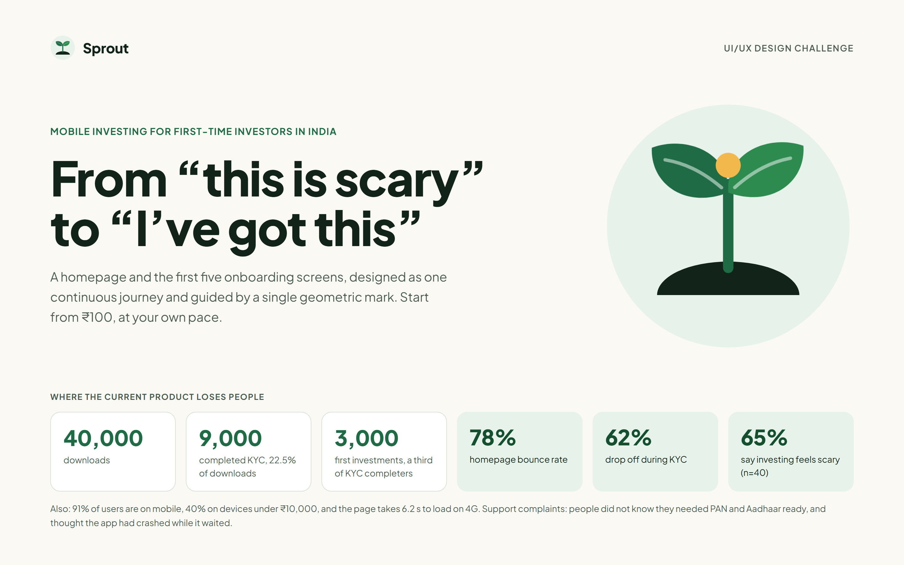

# Sprout 2.0: UI/UX design challenge submission

Redesign of the Sprout investing app homepage (mobile and desktop) and its first five onboarding screens, built as one continuous journey from "this is scary" to "I've got this", guided by a single geometric mascot.

## What is in this repository

| Deliverable | Where |
|---|---|
| Homepage, mobile | [01-home-mobile.png](docs/screenshots/01-home-mobile.png) |
| Homepage, desktop | [07-home-desktop.png](docs/screenshots/07-home-desktop.png) |
| Onboarding 1 to 5 | [02](docs/screenshots/02-onboarding-1-welcome.png), [03](docs/screenshots/03-onboarding-2-checklist.png), [04](docs/screenshots/04-onboarding-3-details.png), [05](docs/screenshots/05-onboarding-4-verification.png), [06](docs/screenshots/06-onboarding-5-start-small.png) |
| Screen 4 loading, slow, error, empty and verified states | [08-screen-4-states.png](docs/screenshots/08-screen-4-states.png) |
| Mascot sheet (poses, static fallback, construction, motion) | [09-mascot-sheet.png](docs/screenshots/09-mascot-sheet.png) |
| Colour and contrast ratios | [10-colour-contrast.png](docs/screenshots/10-colour-contrast.png) |
| Type, tokens, component list, build plan | [11-type-components.png](docs/screenshots/11-type-components.png) |
| Two-page rationale | [12](docs/screenshots/12-rationale-page-1.png), [13](docs/screenshots/13-rationale-page-2.png), and [docs/rationale.md](docs/rationale.md) |
| Clickable coded prototype | [prototype/index.html](prototype/index.html) |
| Design source files (Claude Design canvas) | [design/claude-design-sources](design/claude-design-sources) |
| Figma file | See "Links" below |

## The journey

| Step | Feeling | What the user sees |
|---|---|---|
| Homepage | Curious, wary | One promise (₹100, your pace), one button, three small steps |
| 1 Welcome | Prepared | What you will need and how long it takes |
| 2 Checklist | Prepared | PAN, Aadhaar, bank account; "I'm ready" or "Remind me later" |
| 3 Details | Understood | Every field says why we ask |
| 4 Verification | Reassured | A named status, honest timing, notify-me; loading, slow, error and empty states |
| 5 Start small | In control | ₹100 minimum, the user picks the amount, risk said plainly |

## Mascot

A geometric mark, not a character: a disc, a half-disc of soil, a stem and two leaves. No face, limbs or outline. It grows with the user (seed, sprout, two leaves, a small bud when done), sways slowly using CSS only, and falls back to a static pose when animation is off or reduced motion is on. It doubles as the logo.

## Stakeholder decisions (summary)

* **CEO (premium, minimal, no cartoons):** a mark instead of a character, warm paper ground, deep green, one button per screen.
* **Marketing (mascot, video, ticker, 3 pop-ups, referral banner):** kept the mascot as the mark; cut the ticker, pop-ups and homepage video; moved the referral to one low-priority line after the first investment. Reasons are in [docs/rationale.md](docs/rationale.md).

## Hard constraints

| Constraint | Status |
|---|---|
| Risk disclaimer on every page with investment content, 12 px or larger, visible without scrolling on mobile | One shared bar pinned to the bottom of every mobile screen, 12 px on a 1.5 line height, sticky on desktop |
| No "guaranteed", "safe" or "risk-free" | Checked across all screen copy; the only occurrences are in the checklist that quotes the banned words |
| WCAG AA | All 17 colour pairs pass; lowest text pair is 5.62:1; controls and graphics are 3.71:1 or higher |
| Tap targets 44 px or more | Back 44, chips and rows 44+, fields 54, buttons 56 |
| Page under 1.5 MB, animation under 100 KB | Designed to budget: no images, one font family, inline SVG, CSS-only motion. **Not yet measured in a real build** |
| Hindi later | Wrapping labels, no fixed widths, 1.5 to 1.6 line heights, Noto Sans Devanagari fallback. A sample is on the type board; it needs a native-speaker review |
| One developer, 3 weeks | Native elements only; component list and week-by-week plan on the type board |

Colour ratios, with the pair, use and result for each, are on the colour board.

## Run the coded prototype

Download the repository (or just `prototype/index.html`) and open it in a browser. It is one HTML file with no build step and walks the full journey: homepage, welcome, checklist (with a working reminder sheet), details form with validation, verification states, and the first-investment screen with a working amount stepper.

The screenshots in `docs/screenshots` are the final visual design. The coded prototype follows the same flow, palette and copy.

## Notes on how this was made

The design was produced in Claude Design (Anthropic's canvas tool). The `.dc.html` files in `design/claude-design-sources` are the board sources. They need that tool's runtime to render, so the screenshots are provided for review.

## Links

* Interactive prototype: open `prototype/index.html` locally (no build step, no server needed)
* Figma file: https://www.figma.com/design/5lZrVxoaOxaNfn3PoVT6KZ (an earlier iteration of the same journey; the screenshots here are the final visuals)

## Assumptions to confirm

The 10-minute and 2 to 5 minute estimates, the four verification steps, the OTP flow, the reminder channel (SMS), and the exact disclaimer wording (needs compliance approval). The sample fund is illustrative, not a recommendation.
